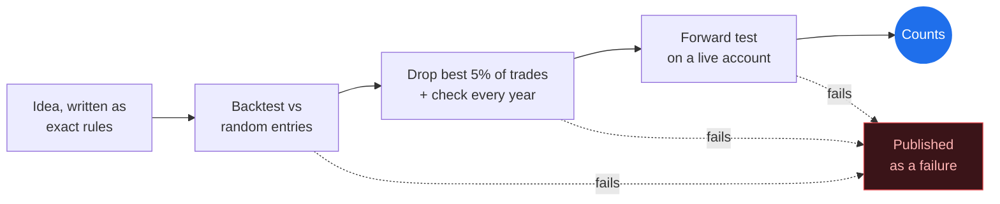

<h1>MGEQuant</h1>
<h3>Honest quant trading research, built in the open.</h3>

Most trading accounts show you the winners. **We publish the failures too**, with the numbers. We build indicators and strategies (started on NQ futures, now testing indices, forex, crypto and stocks), and most ideas do not survive testing. When they don't, we say so.

## Latest from the lab

| Date | What we tested | What we found |
|---|---|---|
| **Oct&nbsp;24** | [IB 25/75 indicator](DevelopmentLogs/Indicators/2026/10-October.md) | **Failed our own check first**: the box matched only 34 of 65 New York sessions. Three timezone bugs fixed. Now matches **65/65 NY, 65/65 Asia, 64/64 London**. |
| **Oct&nbsp;23** | [FlowEdge volume split](DevelopmentLogs/Indicators/2026/10-October.md) | Checked against real trade-by-trade data, the estimate was **backwards on down bars**. Fixed and re-measured. |
| **Oct&nbsp;4** | [90-minute bias strategy](DevelopmentLogs/Strategies/2026/10-October.md) | **~4,100 NQ trades, no edge.** Lost slightly after costs and did no better than random-direction entries. |

## How every idea is graded

Every entry says how far an idea has been tested. **A rule appearing here does not mean it works.**

## What's here

| Section | What you'll find |
|---|---|
| [**Indicators**](DevelopmentLogs/Indicators/2026/10-October.md) | News Wire, Liquidity Heatmap, FlowEdge, IB 25/75 and more |
| [**Strategies**](DevelopmentLogs/Strategies/2026/10-October.md) | The setups we trade by hand, and how far each has been tested |
| [**MarketCoach**](DevelopmentLogs/MarketCoach/2026/09-September.md) | Including a passing test that turned out to be resting on roll gaps |
| [**Platform**](DevelopmentLogs/Platform/2026/10-October.md) | MGE Labs: a NinjaTrader 8 trade journal with prop-account and tilt guards (private beta) |
| [**Screenshots**](Screenshots/) | The tools on real charts |
| [**Mission and vision**](Mission%20and%20Vision/) | Why this exists, and what M-G-E stands for |
| [**Prop-firm calculator**](https://mgequant.github.io/MGEQuant/mgequant-propfirm-calculator.html) | Free tool |

## What we don't do

No trade signals · no trade advice · no performance promises · source code stays private

> [!WARNING]
> Educational and research content only. Not investment advice. Trading futures involves substantial risk of loss. Backtested results are hypothetical and do not represent actual trading.
