<b>Markets:</b> NQ futures → indices · forex · crypto · stocks

<b>Early access and enquiries:</b> DM <a href="https://x.com/MGEQuant">@MGEQuant on X</a>

We build indicators and strategies and publish what we find, **including what fails**. Most ideas do not survive testing, and we say so.

## What's here

| Section | What you'll find |
|---|---|
| [**Indicators**](DevelopmentLogs/Indicators/2026/09-September.md) | News Wire, Liquidity Heatmap, IB 25/75 and more |
| [**Strategies**](DevelopmentLogs/Strategies/2026/09-September.md) | The setups we trade by hand, and how far each has been tested |
| [**MarketCoach**](DevelopmentLogs/MarketCoach/2026/09-September.md) | Including a passing test that turned out to be resting on roll gaps |
| [**Development logs**](DevelopmentLogs/) | What we built, tested and learned |
| [**Screenshots**](Screenshots/) | The indicators on real charts |
| [**Mission and vision**](Mission%20and%20Vision/) | Why this exists |
| [**Prop-firm calculator**](https://mgequant.github.io/MGEQuant/mgequant-propfirm-calculator.html) | Free tool |

## How we work

| Random-entry controls | Out-of-sample checks | Public corrections |
|:---:|:---:|:---:|
| Every edge is compared against random entries | Tested on data the idea never saw | When our numbers are wrong, we fix them in the open |

Every entry says how far an idea has been tested. **A rule appearing here does not mean it works.**

## What we don't do

No trade signals · no trade advice · no performance promises · source code stays private

> [!WARNING]
> Educational and research content only. Not investment advice. Trading futures involves substantial risk of loss. Backtested results are hypothetical and do not represent actual trading.
